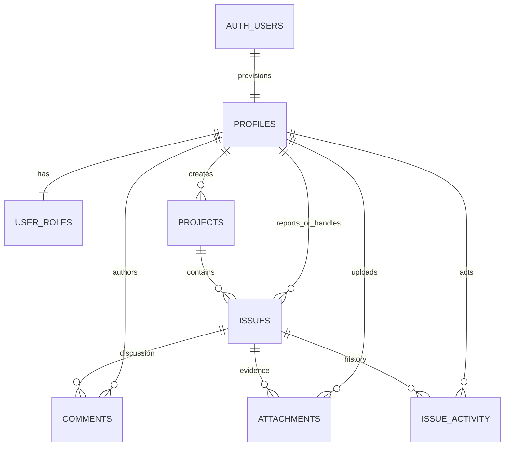

# Architecture

Eight HTML entry points are bundled by Vite. Each has a JavaScript controller; shared rendering and Supabase services live in separate modules. Bootstrap provides layout and accessible form primitives. Netlify serves static assets. Supabase provides Auth, Postgres REST access, database-enforced permissions and private Storage.

All registered users belong to one shared demo team. Guests cannot read team data. Members manage their own issues/comments/files; assignees can change issue status. Admins manage projects, roles, and moderation.

Schema SQL lives under `supabase/migrations`; apply in filename order. The frontend must never receive privileged keys. See PROJECT_PLAN.md for field-level design and acceptance criteria.

## Fixed demo identities

`issueflow_private.demo_accounts` is an additional, non-exposed control table keyed to Auth users. API roles have no schema/table access. Narrow helpers apply restrictive policies to the seven application tables and issue-file bucket, reject effective demo admin access, and protect fixed demo credentials in Auth. The local seed creates no administrator with a known password; private evaluator provisioning is separate.
