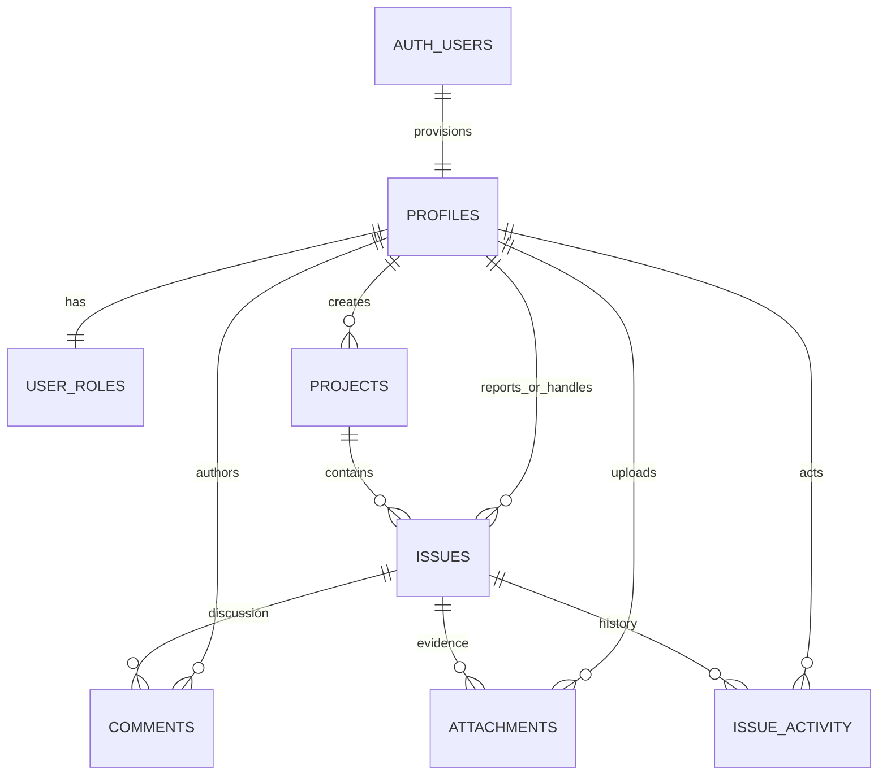

# Architecture

Eight HTML entry points are bundled by Vite. Each has a JavaScript controller; shared rendering and Supabase services live in separate modules. Bootstrap provides layout and accessible form primitives. Netlify serves static assets. Supabase provides Auth, Postgres REST access, database-enforced permissions and private Storage.

Approved users belong to one shared team. Guests and pending accounts cannot read workspace data. Members manage their own issues/comments/files; assignees can change issue status. Admins manage projects, roles, and moderation.

Schema SQL lives under `supabase/migrations`; apply in filename order. The frontend must never receive privileged keys. See PROJECT_PLAN.md for field-level design and acceptance criteria.

## Approval and retired identities

`user_roles.approved` is server-controlled and defaults to false. Restrictive policies require an approved account and a valid Auth session. The historical identity registry remains private; the two retired Auth accounts were deleted after their sample records moved to the approved member. Safe RPCs expose caller status, active assignees, and an admin-only approval queue. Credentials are provisioned separately and never seeded.
