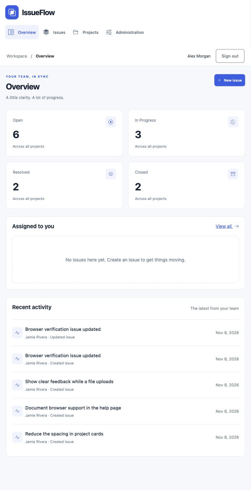

# Assessment evidence

Status on November 8, 2026: implementation through the approved private-workspace update. Maximum points remain a target, not an awarded score.

| Criterion | Evidence | Status |
|---|---|---|
| 15 commits | Public Git history and docs/progress.md | 17 commits after the authorized workflow-review update; two later-day commits pending |
| 3 commit days | Actual Git timestamps | Day 1 only; Nov 9 and 10 reserved |
| Architecture | Eight HTML files, vite.config.js, src/services and components | Build passed |
| Five responsive screens | Eight page controllers, shared responsive CSS | Desktop and 767px browser reviewed; narrow phone widths need further review |
| Four DB tables | Seven tables, versioned SQL, ER diagram | Schema rebuild and hosted migrations verified |
| Admin panel | src/pages/admin.js and set_user_role RPC | Browser access/denial and hosted privilege checks passed |
| File storage | Private bucket migration and attachment service | Hosted byte-equality upload/download and unauthorized-delete denial passed |
| Deployment | [Live app](https://issueflow-petarbinev.netlify.app) | Published from GitHub; production member login, navigation/reload and eight direct routes passed |
| Auth/security | SQL grants/RLS, tests/security.test.js, scripts/verify-hosted.mjs | Four local tests and live API checks passed |
| Documentation | README, architecture, security, deployment, evaluator guide | Setup and evaluator documentation complete; final submission audit reserved for Nov 10 |

Browser checks performed through the real UI: member login, dashboard, search, issue create/edit, comment creation, detail navigation, sign-out/admin login, member admin-page denial, admin panel and projects display. Temporary browser-created issue was removed through trusted cleanup. Responsive viewport requests were clamped to an observed 767px by the available browser; do not claim 375px/1440px verification from those requests.

Security update: retired Auth accounts were deleted after preserving their sample records, all evaluator credentials are private, and workspace access requires approval and a valid session. The three-day requirement remains pending until the November 9/10 commits.

Access update: accounts and passwords are no longer published. The former shared member password was rotated privately and old sessions revoked. Pending-account and retired-assignee checks are included in local/hosted validation.

Browser/API verification now includes the pending-access screen, admin approval/suspension, real role changes, revoked-session denial and filtering retired assignees. No working credential values are published.

Workflow review: the detail page exposes assignment controls for reporters/admins; assigned-only members retain status access. A neutral session-loading header replaces the initial guest link. Twelve generic samples were replaced with authenticated cross-user scenarios. Local checks, hosted permission/file tests and browser create/edit/assignment/status/discussion flows were reviewed; test cleanup uses local-session sign-out.
